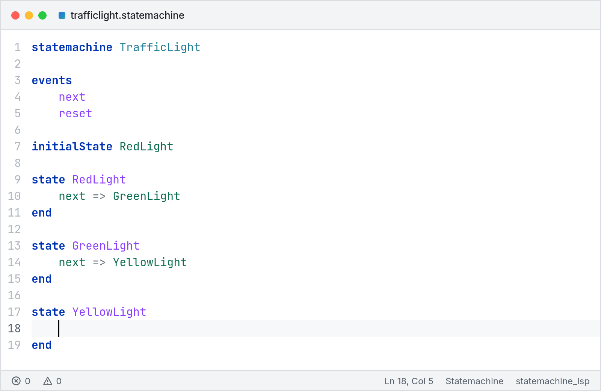

<div align="center">
  <a href="https://github.com/ydaveluy/cursiv">
    <picture>
      <source media="(prefers-color-scheme: dark)" srcset="docs/assets/logo-dark.png">
      
    </picture>
  </a>
  <h3>High-performance C++20 language engineering framework</h3>
</div>

<div align="center">

[](https://github.com/ydaveluy/cursiv/actions/workflows/ci.yml)
[](https://github.com/ydaveluy/cursiv/actions/workflows/docs.yml)
[](https://sonarcloud.io/summary/new_code?id=ydaveluy_pegium)
[](https://github.com/ydaveluy/cursiv-grammar/actions/workflows/ci.yml)

</div>

---

cursiv++ is a C++20 framework for building domain-specific languages and
their tools: parsers, validators, command-line tools and language servers
with Language Server Protocol (LSP) support. Its goal is to be as fast as
possible while staying simple to use: the standard language features work out
of the box, and you can customize every service.

Define your grammar and abstract syntax tree (AST) as C++ types. Cursiv
generates the parser and provides services for a command-line tool or an
editor extension.



[Documentation](docs/index.md) ·
[Try it online](https://ydaveluy.github.io/cursiv/demo/) ·
[Getting started](docs/learn/scaffold.md) ·
[Benchmark results](docs/benchmarks/README.md)

- **C++ grammars and ASTs:** grammar rules fill your structs, and the C++
  compiler checks the bindings.
- **LL and LR parsing:** generated parsers with syntax error recovery.
- **Fast:** performance comes first, from the generated parsers to the editor
  services.
- **Language services:** symbol indexing, scoping, cross-reference resolution,
  validation and formatting, each one customizable.
- **Editor and tool integration:** LSP, command-line and Model Context
  Protocol (MCP) tools, with native and WebAssembly builds.

## Get started

You need CMake 3.30 or later, Git, and a C++20 compiler with `std::format`
and `musttail` support. GCC 16 and Clang 22 are tested.

Create a language project, build it and parse its sample document:

```sh
curl -fsSLO https://raw.githubusercontent.com/ydaveluy/cursiv/main/docs/cursiv-new.cmake
cmake -DNAME=MyLang -P cursiv-new.cmake
cd mylang
cmake -B build -DCMAKE_BUILD_TYPE=Release
cmake --build build --parallel
./build/src/mylang_cli example/hello.mylang
```

The project includes a working grammar, AST, validation, CLI, language
server, tests, benchmark and VS Code extension. The
[language tutorial](docs/learn/walkthrough.md) turns it into your own
language. To add Cursiv to an existing project, see the
[CMake integration guide](docs/reference/cmake.md#add-cursiv-to-a-project).

## Documentation

- [Learn](docs/learn/index.md): create a language, test it and use its AST.
- [Recipes](docs/recipes/index.md): add scoping, validation and formatting.
- [Reference](docs/reference/index.md): grammar, AST, services and CMake APIs.
- [Editor integration](docs/learn/editor-integration.md): build and ship a VS Code extension.
- [WebAssembly](docs/recipes/wasm.md): deploy a WASI language server.

## Examples

Each example includes a grammar, AST, services, tests, a CLI and an editor client:

- [Arithmetics](examples/arithmetics): expressions, operator precedence and evaluation.
- [Statemachine](examples/statemachine): named declarations and cross references.
- [Domainmodel](examples/domainmodel): packages, qualified names, custom scoping and formatting.
- [Requirements](examples/requirements): two languages sharing a server and cross-document references.

For more languages, see [cursiv-grammar](https://github.com/ydaveluy/cursiv-grammar):
more than 300 languages implemented with Cursiv, mostly adapted from
[ANTLR grammars-v4](https://github.com/antlr/grammars-v4). Each one builds on
its own, with a CLI, a language server and tests.

## Performance

Performance is a first-class feature of Cursiv: every part is designed to be
as fast as possible, from the generated parsers to the editor services. The
parsers are compiled C++, workspaces build their documents in parallel, and
editor features stay responsive on large documents and workspaces. Cursiv
suits projects where size and speed matter most.

Each new project includes a benchmark for its language. The
[benchmark page](docs/benchmarks/README.md) shows how to run it and the
framework's results.

## Contributing to Cursiv

See the [contribution guide](CONTRIBUTING.md) for build instructions, tests
and how to propose a change.

## License and acknowledgments

Cursiv is distributed under the [MIT License](LICENSE).

Cursiv is strongly inspired by
[Langium](https://github.com/eclipse-langium/langium), particularly its document
model and configurable language services.
