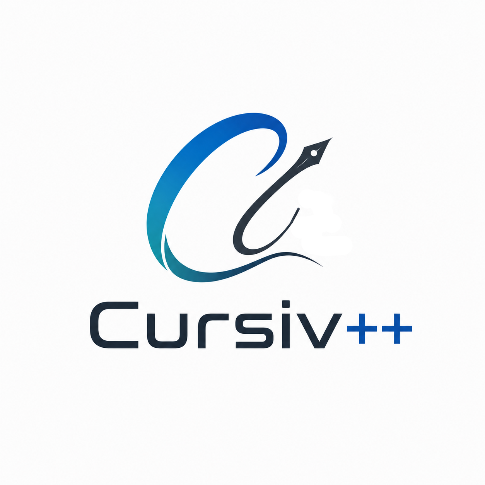

# cursiv++



[](https://github.com/ydaveluy/cursiv/actions/workflows/ci.yml)
[](https://github.com/ydaveluy/cursiv/actions/workflows/docs.yml)
[](https://github.com/ydaveluy/cursiv/actions/workflows/sonarcloud.yml)

cursiv++ is a C++20 framework for building domain-specific languages,
compilers and language tools, with built-in Language Server Protocol (LSP)
support.

Define your grammar and abstract syntax tree (AST) as C++ types. Cursiv
generates the parser and provides services for a command-line tool or an
editor extension.

[Documentation](docs/index.md) ·
[Getting started](docs/learn/scaffold.md) ·
[Benchmark results](docs/benchmarks/README.md)

- **C++ grammars and ASTs:** grammar rules fill your structs, with bindings
  checked by the C++ compiler.
- **LL and LR parsing:** generated parsers with syntax error recovery.
- **Customizable language services:** symbol indexing, scoping, cross-reference
  resolution, validation and formatting.
- **Editor and tool integration:** LSP features, command-line support and
  Model Context Protocol (MCP) tools, with native and WebAssembly builds.

## Get started

You need **CMake 3.30 or later**, **Git**, and a C++20 compiler with
`std::format` and `musttail` support. CI tests **GCC 16** and **Clang 22**.

Create a language project, build it and parse its sample document:

```sh
curl -fsSLO https://raw.githubusercontent.com/ydaveluy/cursiv/main/docs/cursiv-new.cmake
cmake -DNAME=MyLang -P cursiv-new.cmake
cd mylang
cmake -B build -DCMAKE_BUILD_TYPE=Release
cmake --build build --parallel
./build/src/mylang_cli example/hello.mylang
```

The project includes a working grammar, AST types, validation hooks, a CLI,
a language server, tests, a benchmark and a VS Code extension.

Follow the [language tutorial](docs/learn/walkthrough.md) to define your AST,
write grammar rules and add validation. CMake regenerates the parser when
you build after a grammar change.

To use Cursiv in an existing project, see the
[CMake integration guide](docs/reference/cmake.md#consuming-cursiv).

## Documentation

Choose a guide for your next task:

- [Learn](docs/learn/index.md): create a language, test it and use its AST.
- [Recipes](docs/recipes/index.md): add scoping, validation and formatting.
- [Reference](docs/reference/index.md): look up grammar, AST, services and CMake APIs.
- [Editor integration](docs/learn/editor-integration.md): build and ship a VS Code extension.
- [WebAssembly](docs/recipes/wasm.md): deploy a WASI language server.

## Examples

Each example includes a grammar, AST, services, tests, a CLI and an editor client:

- [Arithmetics](examples/arithmetics): expressions, operator precedence and evaluation.
- [Statemachine](examples/statemachine): named declarations and cross references.
- [Domainmodel](examples/domainmodel): packages, qualified names, custom scoping and formatting.
- [Requirements](examples/requirements): two languages sharing a server and cross-document references.

## Benchmarks

Use your project's benchmark executable to measure parsing, workspace builds
and editor services. See the [benchmark results](docs/benchmarks/README.md)
for the framework measurements and how to reproduce them.

## Contributing to Cursiv

See the [contribution guide](CONTRIBUTING.md) for build instructions, tests
and how to propose a change.

## License and acknowledgments

Cursiv is distributed under the [MIT License](LICENSE).

Cursiv is strongly inspired by
[Langium](https://github.com/eclipse-langium/langium), particularly its document
model and configurable language services.
